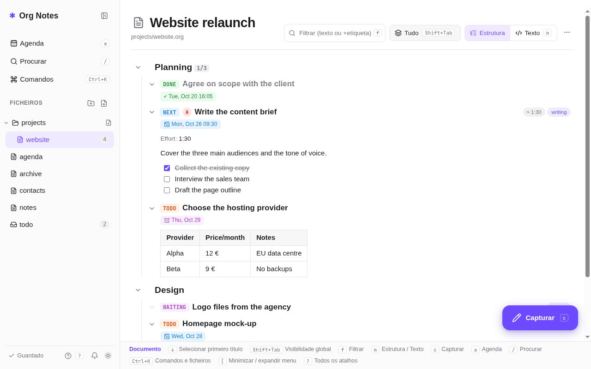
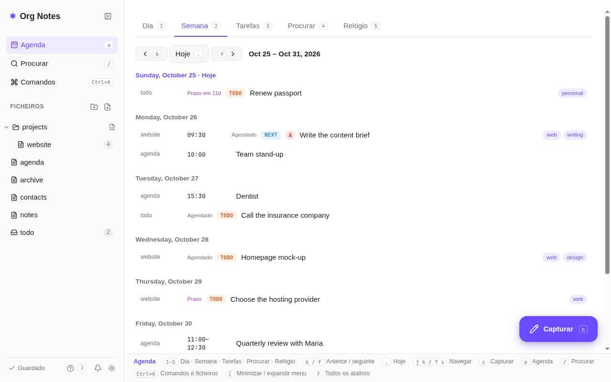
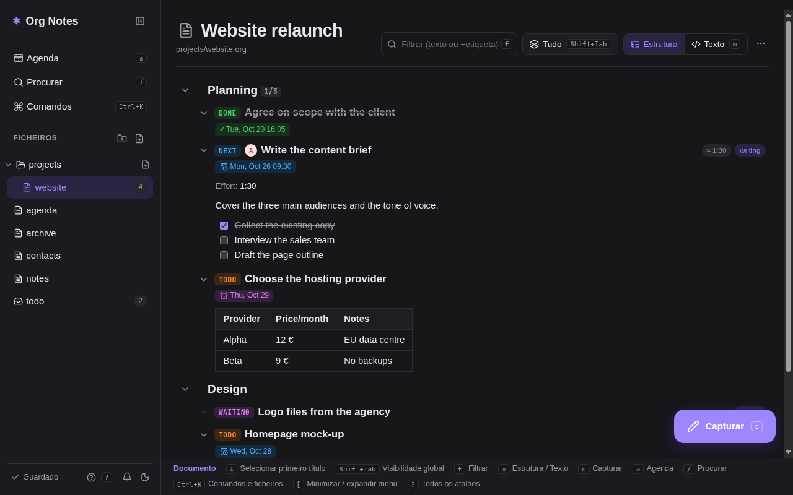
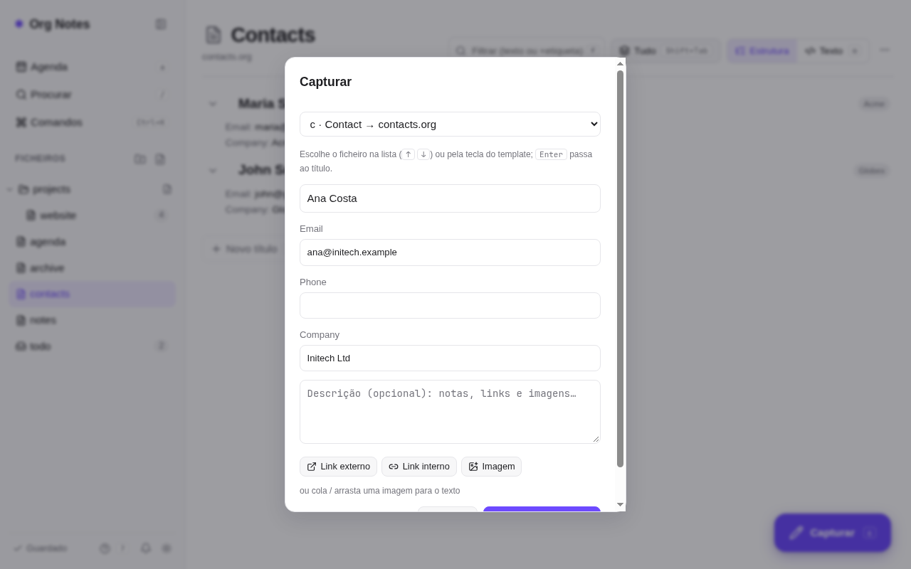
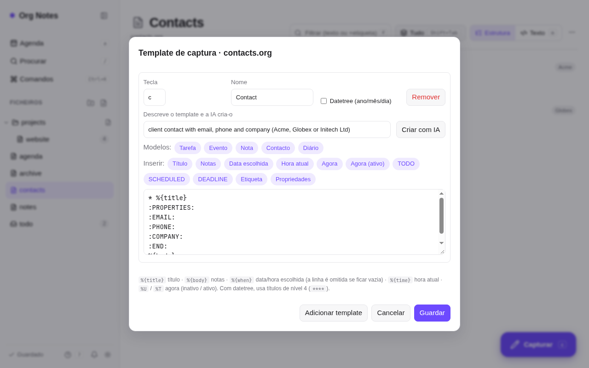

# Org Notes

Org-mode on the web: **React + TypeScript** (Vite) on the frontend, **ASP.NET Core (.NET 10)** on the backend.
Files are plain `.org` files kept in a folder, so they stay compatible with Emacs. The interface is available in
Portuguese, English, French and Spanish (the screenshots and the labels quoted below are the Portuguese ones).



| Agenda | Dark theme |
|---|---|
|  |  |

## Architecture

- **Server** (`server/`, on a remote machine): the site and the API in one ASP.NET Core process, the users' notes,
  and the agenda reminders sent through ntfy (so they reach phones even with every computer off).
- **Local app** (`capture/`, on each user's computer): sits in the tray, opens the capture form with a global shortcut
  and shows the agenda reminders as native notifications. It holds no notes: everything goes through the API, with
  the user's personal token.

## Running

```bash
# production (a single process)
cd client && npm install && npm run build   # builds into server/wwwroot
cd ../server && dotnet run                  # http://localhost:5080

# development (hot reload)
cd server && dotnet run
cd client && npm run dev                    # http://localhost:5173 (proxies /api to 5080)

# tests for the org core
cd client && npm test
```

The notes folder is set in `server/appsettings.json` → `OrgDirectory`
(default `server/data`; it can be e.g. `/home/me/org`). Each user's files live in `<OrgDirectory>/users/<email>/`;
every new user starts with `todo.org`, `agenda.org`, `notes.org`, `contacts.org` and `archive.org`.

## Languages

The language is a per-user setting, chosen in *Conta e notificações* (Account and notifications) or in the command
palette (<kbd>Ctrl+K</kbd>). It is stored on the server, so the site on every device, the notifications and the capture
app all follow it. Before signing in, the login page uses the browser's language and has its own PT · EN · FR · ES links.
The site's texts are keyed by their Portuguese wording: translations live in `client/src/i18n/{en,fr,es}.ts`
(a test checks that every text has all three), and the server's and the capture app's in their `Strings.cs`.

## Packages

`deploy/package.sh` builds two zips into `dist/` (not in git), both with .NET included:

- **`OrgNotes-server-linux-x64.zip`**, for the server (Debian/Ubuntu): `sudo ./install.sh notes.example.com` installs it
  in `/opt/org-notes` as the `org-notes` systemd service, keeps the notes in `/var/lib/org-notes`, and puts
  [Caddy](https://caddyserver.com) in front for HTTPS. Without a domain it listens on port 5080 over plain HTTP.
  Running it again updates the server and leaves the notes alone. The zip ships `server/appsettings.Local.json`
  (allowed emails and AI key), so keep it private.
- **`OrgNotes-client-win-x64.zip`**, for each user's Windows computer: double-click `install.cmd` and give the server's
  address. It installs the local app in `%LOCALAPPDATA%\OrgNotes\capture`, starts it at sign-in and adds
  *Start → Org Notes* for the site. No admin rights are needed. The app then asks for the personal token.
  The server package carries this installer too: signed-in users download it from *Conta e notificações*
  (*Descarregar para Windows*), next to their token. Once installed, the app updates itself: every hour it compares
  its commit with the installer's on the server and, while the capture window is closed, swaps in the new version.

## Continuous deployment

Every push to `main` runs the tests and, if they pass, deploys the server to the Google Cloud VM
(`.github/workflows/deploy.yml`, which runs `deploy/google-cloud.sh`). The script can also be run by hand:
`NAME=<vm> ZONE=<zone> TIMEZONE=Europe/Lisbon deploy/google-cloud.sh <duckdns-subdomain> <duckdns-token>`.

One-time setup, with `gcloud` logged in to the VM's project and `gh` to the repository:

```bash
P=$(gcloud config get-value project) SA=github-deploy@$(gcloud config get-value project).iam.gserviceaccount.com
gcloud iam service-accounts create github-deploy
for r in compute.instanceAdmin.v1 compute.securityAdmin iam.serviceAccountUser; do
  gcloud projects add-iam-policy-binding $P --member serviceAccount:$SA --role roles/$r
done
gcloud iam service-accounts keys create key.json --iam-account $SA
gh secret set GCP_CREDENTIALS < key.json && rm key.json
gh secret set APPSETTINGS_LOCAL < server/appsettings.Local.json   # allowed emails and AI key
gh secret set DUCKDNS_TOKEN
gh variable set DUCKDNS_SUBDOMAIN --body <subdomain>
gh variable set GCE_NAME --body <vm>; gh variable set GCE_ZONE --body <zone>; gh variable set TIMEZONE --body Europe/Lisbon
```

## Agenda notifications

Reminders arrive even with the site closed: N minutes before each timed item (`SCHEDULED`, `DEADLINE`,
active timestamps, repeats included), a daily summary (today, overdue, upcoming deadlines) and, at summary time,
one reminder per deadline (`DEADLINE`) 7, 3, 1 and 0 days ahead (`DeadlineReminders`). Two channels:

- **ntfy**: each user has a secret topic, shown and switched on or off in *Conta e notificações* (Account and
  notifications, bell icon in the menu). Receive it in the ntfy app (Android/iOS) or on a PC with `ntfy subscribe <url>`.
  Off by default.
- **Native** (`notify-send` on Linux, a toast on Windows): shown by the local app on each computer it runs on. It gets
  the day's reminders from `/api/reminders`, already worked out and translated by the server, and shows each once
  when it is due. On by default; *Mostrar lembretes da agenda neste computador* in its settings turns it off.

Settings are in the server's `appsettings.json` → `Notifications` (`MinutesBefore`, `DailySummaryAt`, `DeadlineReminders`, `NtfyServer`, `Enabled`).

## Capture templates

Each file defines its own capture templates in its header (*Template de captura*, capture template, in the file menu). Empty properties
in a template become fields in the capture form, and a `#+PROPERTY: <NAME>_ALL` line gives a field its suggested values:

```org
#+PROPERTY: COMPANY_ALL Acme Globex "Initech Ltd"
#+BEGIN_CAPTURE c Contact
,* %{title}
:PROPERTIES:
:EMAIL:
:COMPANY:
:END:
%{body}
#+END_CAPTURE
```

Properties with suggested values also show as badges next to each headline in the outline.
With AI configured, the template editor can write a template from a plain description (*Criar com IA*, create with AI).

| Capture form | Template editor |
|---|---|
|  |  |

## Capture app (global shortcut, no browser)

`capture/` is a small app (.NET + Avalonia) that sits in the tray and opens the capture form with a global
shortcut: pick the template by its key, type the title, date/time, property fields and notes, <kbd>Ctrl+Enter</kbd> saves, <kbd>Esc</kbd> closes.
It also shows the agenda reminders (see above). It uses the files' templates and saves through the server (`/api/capture`). On first run it asks for the server and
your personal token (on the site: bell → *Conta e notificações*). Settings are in `~/.config/orgnotes/capture.json`
or `%APPDATA%\orgnotes\capture.json`.

```bash
# Linux
cd capture && dotnet publish -c Release -r linux-x64 --self-contained -o ~/.local/share/orgnotes-capture
# Windows (can be built on Linux)
cd capture && dotnet publish -c Release -r win-x64 --self-contained -o publish-win
```

- **Windows**: run `OrgNotes.Capture.exe`; the app registers the shortcut (default <kbd>Win+Alt+C</kbd>), and
  *Arrancar com o Windows* (start with Windows) is in the settings (tray icon → *Definições*).
- **Linux (Hyprland/Omarchy)**: Wayland does not let apps register global shortcuts, so bind a key to
  `OrgNotes.Capture --show` (it wakes the tray instance) and start the app with the session:
  ```lua
  -- ~/.config/hypr/bindings.lua
  o.bind("SUPER + ALT + C", "Org Notes capture", "/home/<me>/.local/share/orgnotes-capture/OrgNotes.Capture --show")
  -- ~/.config/hypr/autostart.lua
  o.launch_on_start("/home/<me>/.local/share/orgnotes-capture/OrgNotes.Capture")
  ```
  It runs through XWayland; each monitor's scale comes from `hyprctl` (or set a fixed `"Scale"` in the settings).

## AI text review

In the capture form (site and app) and in the section editor, the ✨ button opens the AI modes: **Desenvolver**
(develop, <kbd>Alt+R</kbd>: fixes, clarifies, structures and expands the ideas), **Corrigir** (fix, <kbd>Alt+Shift+R</kbd>:
spelling and grammar only), **Resumir** (summarize), **Tom profissional** (professional tone) and **Extrair tarefas**
(extract tasks as checkboxes). It never invents names, dates or numbers (it writes `[definir]` instead). Suggestions
are shown word by word, to accept or discard.
The button only appears when AI is configured under `Ai`.
Put the keys in `server/appsettings.Local.json` (ignored by git) or in environment variables (`Ai__ApiKey`, ...).

- **Claude** (Anthropic API, billed separately from the subscription): just `ApiKey` (or `ANTHROPIC_API_KEY`); `Model` is optional
  (default `claude-opus-5-5`).
- **Any OpenAI-compatible API**: `BaseUrl`, `Model` and `ApiKey` (no key for Ollama). `Model` takes a
  list (`"gemini-3.5-flash,gemini-3.5-flash-lite"`): when one model runs out of free quota (429) the next one is used. For example:

| Provider | `BaseUrl` |
|---|---|
| Google Gemini (free tier in AI Studio) | `https://generativelanguage.googleapis.com/v1beta/openai` |
| Groq | `https://api.groq.com/openai/v1` |
| Mistral | `https://api.mistral.ai/v1` |
| OpenRouter | `https://openrouter.ai/api/v1` |
| Ollama (local) | `http://localhost:11434/v1` |

```json
{ "Ai": { "BaseUrl": "https://generativelanguage.googleapis.com/v1beta/openai", "Model": "<AI Studio model>", "ApiKey": "..." } }
```

The text of your notes is sent to the chosen provider; free tiers may use it for training (check their terms).

## Login

The site always requires a login, and only allowed emails get in: the ones in `Auth:AllowedEmails` plus those the
administrator adds on the site (*Conta e notificações* → *Gerir logins*, kept in `<OrgDirectory>/allowed.json`). The
administrators are `Auth:Admins`, or else the first allowed email; only they see that page.
By default you sign in with email and password: the first time, each allowed email picks its password in *Criar password*
(create password). Anyone who knows an allowed email that has no password yet could set one first, so create yours right away.
Files from older versions without login (directly in `OrgDirectory`) move to the first user's folder.

Optionally, *Entrar com Google* and *Entrar com Microsoft (Office)* (sign in with Google / Microsoft) buttons, each enabled when its `ClientId` and
`ClientSecret` are set. The account's email must be in `AllowedEmails`. Google and Microsoft only accept HTTPS on a domain
(or `http://localhost`).

- **Google**: [Google Cloud Console](https://console.cloud.google.com/apis/credentials) → *Create credentials* → *OAuth client ID*
  → *Web application*, with redirect URI `https://<your-domain>/signin-google`.
- **Microsoft** (Microsoft 365 work/school accounts and personal Outlook/Hotmail accounts): [Entra admin center](https://entra.microsoft.com)
  → *App registrations* → *New registration*, *Accounts in any organizational directory and personal Microsoft accounts*,
  redirect URI (Web) `https://<your-domain>/signin-microsoft`; then *Certificates & secrets* → *New client secret*.

Pass the secrets through environment variables or `server/appsettings.Local.json` (outside git), not `appsettings.json`:
`Auth__AllowedEmails__0=me@gmail.com`, `Auth__AllowedEmails__1=...`, `Auth__Google__ClientId`, `Auth__Google__ClientSecret`,
`Auth__Microsoft__ClientId`, `Auth__Microsoft__ClientSecret`.

### Deploying on a VPS (Debian/Ubuntu)

The server package's `install.sh` does all of this. By hand:

Google only accepts HTTPS on a domain, so the app sits behind [Caddy](https://caddyserver.com) (automatic certificate)
and listens only on `localhost:5080`.

```bash
# on your machine: build and copy
cd client && npm run build && cd ../server && dotnet publish -c Release -r linux-x64 --self-contained -o publish
rsync -a publish/ root@vps:/opt/org-notes/

# on the VPS
apt install caddy
echo 'notes.example.com { reverse_proxy localhost:5080 }' > /etc/caddy/Caddyfile && systemctl reload caddy
useradd -r -m -d /var/lib/org-notes org-notes
cat > /etc/systemd/system/org-notes.service <<UNIT
[Service]
User=org-notes
WorkingDirectory=/opt/org-notes
ExecStart=/opt/org-notes/OrgNotes.Server
Environment=OrgDirectory=/var/lib/org-notes
Environment=Auth__Google__ClientId=...apps.googleusercontent.com
Environment=Auth__Google__ClientSecret=...
Environment=Auth__AllowedEmails__0=me@gmail.com
Restart=always
[Install]
WantedBy=multi-user.target
UNIT
systemctl enable --now org-notes
```

## Features

- **Structure**: nested headlines, folding per section (Tab) and globally (Shift+Tab, `#+STARTUP`), moving/promoting subtrees, narrowing to a subtree, filter/sparse tree by text or tags.
- **Tasks**: configurable TODO states (`#+TODO: TODO NEXT | DONE`), priorities, tags (with inheritance and `#+FILETAGS`), automatic `CLOSED`, repeaters (`+1w`, `++1w`, `.+1d`) with `LAST_REPEAT`, `[n/m]` and `[%]` cookies.
- **Dates**: `SCHEDULED`, `DEADLINE` with warning (`-3d`), active/inactive timestamps, time and date ranges.
- **Agenda**: day/week (overdue, upcoming deadlines, repeats), global task list, text search and tag/property search (org syntax: `a+b-c|TODO="NEXT"`, `Effort>1:00`, `/NEXT`).
- **Clock**: clock in/out in `:LOGBOOK:`, running-clock indicator, weekly time report.
- **Capture**: each file defines its templates in a `#+BEGIN_CAPTURE <key> <name> [:datetree]` block in its header (editable in *Template de captura* in the file menu). Defaults: task → `todo.org`, event → `agenda.org`, note → `notes.org`, contact → `contacts.org`. Placeholders: `%{title}`, `%{body}`, `%{when}`, `%{time}`, `%U`, `%T`. Empty properties become form fields, with suggested values from `#+PROPERTY: <NAME>_ALL`.
- **Refile** to any headline/file and **archive** to `archive.org` with `ARCHIVE_*` properties.
- **Content**: emphasis, links (web, `file:`, `*Headline`, `#custom-id`), images, lists (ordered, description, clickable checkboxes), tables (Tab aligns and jumps between cells), src/quote/example/verse/center blocks, drawers, properties, footnotes.
- **Editing**: per-section editing (Enter), double-click a headline's title or description to edit just that, full text mode, undo/redo, autosave, reloads external changes when the window regains focus.
- **Files**: folders (optionally created with a set of files), file icons.
- **Export**: HTML, `.org`, print/PDF. Light/dark theme, phone layout. Shortcuts: press `?`.
- **Languages**: Portuguese, English, French and Spanish, per user; dates follow the chosen language.

## Not included

Code execution (Babel), table formulas (`#+TBLFM`, shown but not computed), LaTeX, column view, habits, attachments,
ODT/LaTeX export.
